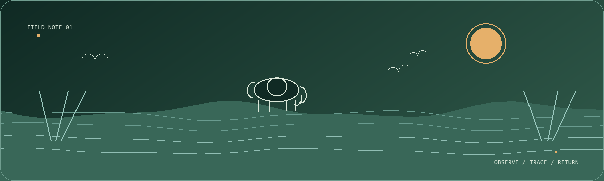

# Jannatul Nayeem

<p align="center">
  
</p>

<p align="center">
  <strong>Zoology undergraduate · wildlife conservation · biodiversity field notes</strong>
</p>

<p align="center">
  <a href="https://nay3m.github.io">Portfolio</a>
  &nbsp;·&nbsp;
  <a href="https://www.linkedin.com/in/nay3m">LinkedIn</a>
  &nbsp;·&nbsp;
  <a href="mailto:jannat.nay3m@gmail.com">Email</a>
</p>

<br />

## Field note

I’m a Zoology student at **Jahangirnagar University**, building a field-ready foundation in wildlife conservation, ecology, biodiversity, and GIS-supported research.

My work-in-progress direction is simple: **notice living systems carefully, record change honestly, and turn field observations into useful conservation questions.**

```text
BASECAMP     Department of Zoology · Jahangirnagar University
LOCATION     Dhaka, Bangladesh
GRADUATION   Expected 2028
FOCUS        Wildlife conservation · ecology · biodiversity · habitat assessment
```

## What I’m learning to notice

| Field direction | Questions I return to |
| --- | --- |
| **Wildlife conservation & management** | What pressures shape a species’ chances of persisting? |
| **Wildlife ecology & behaviour** | What do presence, movement, and behaviour reveal about a living system? |
| **Biodiversity & species monitoring** | How can careful records make change more visible? |
| **Habitat assessment** | Which edges, structures, and signs of pressure matter most? |
| **GIS for wildlife research** | How can spatial context make a wildlife question clearer? |
| **Human–wildlife interactions** | What does coexistence look like from both sides of a boundary? |

## Toolkit

<p>
  
  
  
  
</p>

I’m currently strengthening the technical layer behind field questions: spatial thinking with **QGIS**, reproducible analysis with **R/RStudio**, and beginner-level scripting with **Python**.

## Trail so far

- **BSc in Zoology** — Jahangirnagar University, expected 2028
- **Volunteer** — Butterfly Fair 2026
- **Scout** — Uttara Government College, July 2021–March 2022
- **Intern** — Insect Rearing and Experimental Station, supervised by Dr. Kabirul Bashar *(details being confirmed)*

## Beyond the screen

I’m interested in the small, repeatable practices that make conservation work stronger: keeping consistent field notes, comparing observations across habitats, mapping patterns, and staying curious about the people who share those landscapes.

<p align="center">
  <i>Observe · trace · return</i>
</p>

<p align="center">
  <a href="https://nay3m.github.io"></a>
</p>

<p align="center">
  <sub>Jannatul Nayeem · wildlife field notes · built with attention to living systems</sub>
</p>
